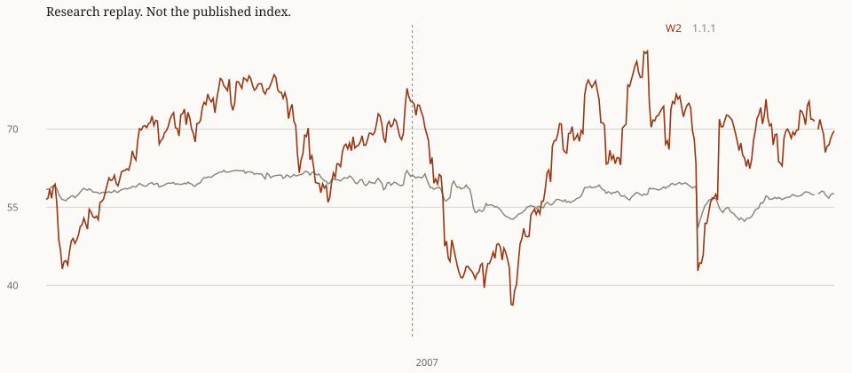

# Combined 2.0 design, research replay

Research only. This note does not change `compute_index`, methodology 1.1.1, `docs/data/latest.json`, or the weekly history. It does not cut a version.

Recommendation: adopt W2 with the four-quarter debt change, the VIX, and the live bands, if a 2.0.0 is cut. Today on that config is 69.39 Moderate. Out of sample it is Critical in 4 of 236 months, and those months are 2010–2011, not October 2008 and not April 2020. October 2008, October 2009, and April 2020 are Low, and they sit below the 2015–2019 floor. The design does not do what Option C did. Option C, in the endpoint-and-band replay, put 59 of 236 months in Critical and scored the current reading High. This note does not recompute Option C. It treats that pattern, Critical sprayed across ordinary months and today pushed into High, as the failure to avoid.

The recommended config is weight set W2, the four-quarter change in the debt-to-GDP ratio, the VIX monthly mean, and the live bands at 70, 55, and 40. W1, the one-quarter debt change, NFCI in place of the VIX, and the episode bands were run and are not the recommendation. Crime stays on the 1.1.1 weight and the 500–8,000 endpoints.

## Comparison

1.1.1 uses the live endpoints, the debt-to-GDP level, and the live weights. Homelessness is 0.22 and trust is 39 on every historical month, the methodology 1.1.1 checklist, not a reconstructed path. W1 and W2 use the frozen inflation and unemployment endpoints, a debt change, and a financial-stress input. The episode column is the W2 score under the alternative bands, not a different index.

| Reading | 1.1.1 | W1, YoY, VIX | W2, YoY, VIX | W2, QoQ, VIX | W2, YoY, NFCI | W2 episode |
| --- | --- | --- | --- | --- | --- | --- |
| Oct 2008 | 56.89 Moderate | 40.76 Low | 44.60 Low | 44.60 Low | 46.31 Low | 44.60 Low |
| Oct 2009 | 56.97 Moderate | 42.34 Low | 42.77 Low | 42.77 Low | 42.97 Low | 42.77 Critical |
| Mar 2020 | 59.03 Moderate | 60.02 Moderate | 63.22 Moderate | 61.69 Moderate | 67.03 Moderate | 63.22 Moderate |
| Apr 2020 | 50.98 Low | 39.61 Critical | 42.80 Low | 42.80 Low | 46.33 Low | 42.80 Critical |
| Jun 2022 | 52.28 Low | 63.08 Moderate | 64.49 Moderate | 64.49 Moderate | 66.26 Moderate | 64.49 Moderate |
| Sep 2018 (2015–19 typical) | 58.93 Moderate | 77.01 High | 74.38 High | 71.94 High | 71.14 High | 74.38 High |
| Aug 2026 monthly | 57.56 Moderate | 71.65 High | 69.64 Moderate | 72.91 High | 67.17 Moderate | 69.64 Moderate |
| Today (2026-10-09) | 57.50 Moderate | 71.42 High | 69.39 Moderate | 72.66 High | 66.85 Moderate | 69.39 Moderate |

Today is not the August row. August unemployment in the monthly fixture is the August print. Today uses the September unemployment rate 4.2 from `latest.json` (observation 2026-09-01) and the VIX week ending 2026-10-09 at 15.172. Inflation is still the August year-over-year rate 3.35. The debt change is carried from 2026-01-01. Crime is the April 2026 Nationwide Full Sample rate 2443.27, carried forward. The 1.1.1 column on Today restates homelessness and trust to the checklist (0.22 and 39) and is 57.50. The file on disk stays methodology 1.1.0 at 57.66.

2015–2019 typical is the out-of-sample month closest to the W2 median of that window. That month is Sep 2018 at 74.38. The window itself runs 63.08 to 84.95.

## Do 2008 and 2020 separate?

On W2, October 2008 is 44.60 Low, October 2009 is 42.77 Low, and April 2020 is 42.80 Low. March 2020 is 63.22 Moderate. June 2022 is 64.49 Moderate. The 2015–2019 path runs 63.08 to 84.95 and never enters Low or Critical (High 48, Moderate 12). Those three troughs sit below that floor. The December 2007–December 2009 window still reaches 64.53, so the edges of the window overlap the bottom of the calm range. The troughs do not. Inside that window the count is Low 18, Moderate 7, range 41.27–64.53. 2020 is Low in 7 months and Moderate in 5. 2022 stays Moderate (62.42–69.65) and overlaps the calm floor. W2 is Critical in 4 out-of-sample months. Those Critical months are May 2010 (39.53), Aug 2011 (36.35), Sep 2011 (36.23), Oct 2011 (39.04). They are not October 2008 and they are not April 2020.

March 2020 stays Moderate on W2. The VIX is at its stressed clamp, and its weight is 0.06. Unemployment is still low and the four-quarter debt change has not jumped yet. Both print in April. A financial-stress slot of this size cannot carry March by itself. June 2022 also stays Moderate, and it overlaps the bottom of 2015–2019. Inflation is the stressed input that month. Unemployment is below the frozen p2, so it clamps to fully stable, and the debt ratio is falling, so the change clamps to fully stable as well. The design does not put 2022 in its own crisis band. Methodology 1.1.1 called June 2022 Low because the wide CPI scale and the high debt level both pulled the index down.

The Critical months are the long unemployment aftermath, not the two troughs the bands are being asked about. May 2010 is 39.53, with unemployment norm 8.2, debt-change norm 0.0, VIX norm 13.0, and inflation norm 94.7. The denominator is 0.60 because crime has not started. Aug 2011 is 36.35, with unemployment norm 18.0, debt-change norm 0.0, VIX norm 0.0, and inflation norm 79.3. The denominator is 0.60 because crime has not started. Sep 2011 is 36.23, with unemployment norm 18.0, debt-change norm 0.0, VIX norm 0.0, and inflation norm 78.8. The denominator is 0.60 because crime has not started. Oct 2011 is 39.04, with unemployment norm 21.3, debt-change norm 3.0, VIX norm 9.2, and inflation norm 81.4. The denominator is 0.60 because crime has not started. October 2008 stays Low because unemployment is only partway stressed (norm 59.0) and inflation is still calm (norm 79.5). The VIX and the debt change are both at the unstable clamp, and crime is not in the denominator yet. April 2020 stays Low because inflation is at the stable clamp (norm 100.0) and crime, present by then, is 67.3 on its wide scale. Unemployment, the debt change, and the VIX are at the unstable clamp that month. Those two calm slots are what keep April above 40.

## Weights

Homelessness and trust are 0.09 and 0.12 under 1.1.1, together 0.21 of the 0.72 weight sum. Both are one checklist point, so they shift the level of every month and do not mark a crisis. The financial input is paid for by cutting them, not by cutting inflation, unemployment, crime, or the debt slot.

| Set | Inflation | Crime | Unemployment | Debt change | Homelessness | Trust | Financial | Sum |
| --- | --- | --- | --- | --- | --- | --- | --- | --- |
| 1.1.1 | 0.15 | 0.12 | 0.12 | 0.12 level | 0.09 | 0.12 | none | 0.72 |
| W1, half the checklist block | 0.15 | 0.12 | 0.12 | 0.12 | 0.045 | 0.06 | 0.105 | 0.72 |
| W2, moderate shift | 0.15 | 0.12 | 0.12 | 0.12 | 0.06 | 0.09 | 0.06 | 0.72 |

W1 moves half of the 0.21 block. W2 moves 0.06, about 29 percent of it. The debt slot stays 0.12. Only the series in that slot changes, from the level to the change.

W1 is the set that overcorrects. April 2020 is 39.61 Critical on W1 and 42.80 Low on W2. August 2026 is 71.65 High on W1 and 69.64 Moderate on W2. Today is 71.42 High on W1 and 69.39 Moderate on W2. Out of sample, W1 is Critical in 10 months and High in 109. W2 is Critical in 4 and High in 89. W2 keeps today in Moderate. That is the weight set.

## Debt change

Option A's frozen endpoints, fit on 1970–2006, are 1.40218 to 12.78580 for inflation and 4.00000 to 10.10000 for unemployment. The same window's debt-to-GDP level has p2–p98 endpoints 30.85879 to 64.67284 (148 quarters). From Jul 2008 through the end of the replay, every month is above that ceiling (218 months), so a level slot would clamp to 0, the unstable end. With that clamp, the checklist left where it is, and inflation, unemployment, and crime set to the stable end of their scales, the 1.1.1 index tops out at 69.29. High is 70. A level endpoint from this window cannot reach it. That is why the level is replaced.

The recommended replacement is the four-quarter percentage-point change: this quarter's ratio minus the ratio four quarters earlier. On quarter-start dates from January 1971 through October 2006 the change runs -4.09 to 5.45. The frozen p2–p98 endpoints are -2.76340 to 4.70307 (144 quarters). A change above the top endpoint clamps to 0. A change below the bottom endpoint, a falling ratio, clamps to 100. Other months carry the latest quarter, the same way the live publisher carries the level.

The variant is the one-quarter change. Its 1970–2006 p2–p98 endpoints are -1.24639 to 1.59242 (147 quarters). October 2008, October 2009, April 2020, and June 2022 land on the same clamp under both changes, so those four W2 readings match. They come apart inside the COVID shock. In July 2020 the four-quarter change is still 19.53 percentage points, which is max stress on the frozen scale. The one-quarter change is -8.52, below the frozen floor, so the debt slot clamps to fully stable while unemployment is still elevated. The four-quarter change keeps the debt slot stressed through the rest of the shock. The quarterly change marks the debt slot calm in the same quarter. The one-quarter change also scores today 72.66 High, while the four-quarter change scores today 69.39 Moderate. That is the reason to prefer the four-quarter change.

Out of sample, W2 with the one-quarter change runs 36.23–84.06 and counts High 84, Moderate 97, Low 50, Critical 5. The four-quarter counts are High 89, Moderate 86, Low 57, Critical 4.

## Financial stress

The recommended input is one series: the calendar-month mean of the daily VIX close. The reference window is January 1990 through December 2006, because the CBOE series starts in 1990. It still ends before the 2007 replay, and it is not a rolling window. p2–p98 on that window is 11.29143 to 35.00439 (204 months). Higher is less stable. October 2008 and March 2020 both clamp to 0. The public source is the CBOE daily history. The same close is what FRED publishes as VIXCLS. No licensed credit spread is in this replay.

The variant is the Chicago Fed NFCI credit subindex, alone, without the VIX. It is a public weekly series. The scored input is the mean of the Fridays in the month. p2–p98 on January 1971 through December 2006 is -2.83230 to 3.16320 (432 months). It does mark 2008. It does not mark March 2020 as a credit break: the monthly mean that month normalizes to 45.8 on this scale, near the middle, because the Federal Reserve's facilities sat on top of the credit indexes. The W2 NFCI reading for March 2020 is 67.03 Moderate. The VIX reading for the same month is 63.22 Moderate. Out of sample, NFCI never reaches Critical (High 65, Moderate 108, Low 63, Critical 0, range 40.56–80.37). A blend of VIX and NFCI would dilute the one month the financial slot is there to see. The VIX is the cleaner single input.

## Crime endpoints

Crime stays at 500–8,000, inverted, weight 0.12. There is no RTCI path before January 2018, so a 1970–2006 percentile is not available. Fitting endpoints on 2018–2026 would use the replay itself. That was not done. On the file that does exist, the Nationwide Full Sample rate runs 2443.27 to 3137.69, and the live scale only uses 9.3 percent of the 0–100 norm (norms 64.83 to 74.09). Crime still compresses the index. Tightening it would be a separate decision, and it would be look-ahead if the fit used these years.

## Bands

The recommended bands are the live cutoffs: High at or above 70, Moderate at or above 55, Low at or above 40, Critical below 40. They were not refit on 2008, 2020, or 2022.

The one alternative is an episode rule, fit only through 2006. The stress anchor is the W2 score in the month of the highest VIX inside the July 1990–March 1991 recession, which is Oct 1990 (VIX monthly mean 29.63, W2 43.15, denominator 0.60 because crime is absent). That month is also the lowest in-sample W2 score. The rule did not search for the minimum. The calm anchor is the median W2 score from January 1995 through December 2006, 71.31. The midpoint is 57.23. Critical is below the stress anchor, Low is below the midpoint, Moderate is below the calm anchor, and High is at or above it. Nothing in that rule looks at 2008, 2020, or 2022. Out of sample the episode labels are High 69, Moderate 99, Low 52, Critical 16. October 2008 would be Low, April 2020 Critical, June 2022 Moderate, and today Moderate. The stress anchor is 43.15, between October 2008 (44.60) and the two lower troughs, October 2009 (42.77) and April 2020 (42.80). Both of those troughs are Critical under the episode rule. That is 16 Critical months out of sample, against 4 under the live bands. The live cutoffs already put October 2008, October 2009, and April 2020 in Low, keep 2015–2019 above Low, and leave today in Moderate. The episode rule uses the same W2 scores and a higher Critical cutoff (43.15 instead of 40). It is reported and not adopted.

## Distribution

January 1990 through December 2006 is inside the VIX reference window and inside the 1970–2006 window used for CPI, unemployment, and the debt change. It is in-sample. Crime is absent before 2018, so the denominator is 0.60 on W2 until then and 0.72 from January 2018. October 2025 drops inflation and unemployment (the appropriations-lapse blank) and the denominator shrinks again. The decision sample is January 2007 through August 2026.

| Config | Sample | Months | Min | Max | Mean | SD | High | Moderate | Low | Critical |
| --- | --- | --- | --- | --- | --- | --- | --- | --- | --- | --- |
| 1.1.1 | Jan 2007–Aug 2026 | 236 | 50.98 | 61.39 | 56.74 | 2.10 | 0 | 182 | 54 | 0 |
| W1, four-quarter debt, VIX, live bands | Jan 2007–Aug 2026 | 236 | 32.39 | 88.61 | 64.71 | 13.21 | 109 | 72 | 45 | 10 |
| W2, four-quarter debt, VIX, live bands | Jan 2007–Aug 2026 | 236 | 36.23 | 84.95 | 63.63 | 11.95 | 89 | 86 | 57 | 4 |
| W2, one-quarter debt, VIX, live bands | Jan 2007–Aug 2026 | 236 | 36.23 | 84.06 | 63.87 | 12.13 | 84 | 97 | 50 | 5 |
| W2, four-quarter debt, NFCI, live bands | Jan 2007–Aug 2026 | 236 | 40.56 | 80.37 | 62.20 | 10.75 | 65 | 108 | 63 | 0 |
| W2, four-quarter debt, VIX, episode bands | Jan 2007–Aug 2026 | 236 | 36.23 | 84.95 | 63.63 | 11.95 | 69 | 99 | 52 | 16 |
| 1.1.1 | 1990–2006, in-sample | 204 | 56.25 | 62.11 | 59.83 | 1.41 | 0 | 204 | 0 | 0 |
| W2, four-quarter debt, VIX, live bands | 1990–2006, in-sample | 204 | 43.15 | 80.44 | 67.21 | 9.02 | 95 | 86 | 23 | 0 |
| W2, four-quarter debt, VIX, live bands | Dec 2007–Dec 2009 | 25 | 41.27 | 64.53 | 48.74 | 7.81 | 0 | 7 | 18 | 0 |
| W2, four-quarter debt, VIX, live bands | 2020 | 12 | 42.80 | 69.70 | 54.04 | 9.20 | 0 | 5 | 7 | 0 |
| W2, four-quarter debt, VIX, live bands | 2022 | 12 | 62.42 | 69.65 | 65.88 | 2.39 | 0 | 12 | 0 | 0 |
| W2, four-quarter debt, VIX, live bands | 2015–2019 | 60 | 63.08 | 84.95 | 73.90 | 5.87 | 48 | 12 | 0 | 0 |
| 1.1.1 | 2015–2019 | 60 | 56.37 | 59.75 | 58.34 | 0.87 | 0 | 60 | 0 | 0 |

W2 out of sample is High in 89 of 236 months and Critical in 4. The 1.1.1 replay of the same months is High in 0 and Critical in 0, range 50.98–61.39. The in-sample W2 path is 43.15–80.44, High 95, Moderate 86, Low 23, Critical 0. Do not read the in-sample band counts as confirmation. The endpoints were fit on that era.

W2 in the December 2007–December 2009 window: 41.27–64.53, Low 18, Moderate 7, High 0, Critical 0. In 2020: Low 7, Moderate 5, High 0, Critical 0. In 2022: Moderate 12, High 0, Low 0, Critical 0, range 62.42–69.65.

### W2 components at the readings that matter

Norms are 0–100, higher meaning more stable, before the weight. Homelessness and trust are the checklist on every row (norms 56.00 and 48.75).

| Reading | Index | Inflation | Unemployment | Debt change | Crime | VIX | Denominator |
| --- | --- | --- | --- | --- | --- | --- | --- |
| Oct 2008 | 44.60 | 79.5 | 59.0 | 0.0 | missing | 0.0 | 0.60 |
| Oct 2009 | 42.77 | 100.0 | 1.6 | 0.0 | missing | 45.3 | 0.60 |
| Mar 2020 | 63.22 | 99.2 | 93.4 | 30.4 | 66.9 | 0.0 | 0.72 |
| Apr 2020 | 42.80 | 100.0 | 0.0 | 0.0 | 67.3 | 0.0 | 0.72 |
| Jun 2022 | 64.49 | 33.4 | 100.0 | 100.0 | 66.3 | 28.6 | 0.72 |
| Sep 2018 | 74.38 | 91.8 | 100.0 | 54.4 | 66.0 | 93.2 | 0.72 |
| Aug 2026 | 69.64 | 82.9 | 98.4 | 35.6 | 74.1 | 83.4 | 0.72 |
| Today | 69.39 | 82.9 | 96.7 | 35.6 | 74.1 | 83.6 | 0.72 |
| May 2010 Critical | 39.53 | 94.7 | 8.2 | 0.0 | missing | 13.0 | 0.60 |
| Aug 2011 Critical | 36.35 | 79.3 | 18.0 | 0.0 | missing | 0.0 | 0.60 |
| Sep 2011 Critical | 36.23 | 78.8 | 18.0 | 0.0 | missing | 0.0 | 0.60 |
| Oct 2011 Critical | 39.04 | 81.4 | 21.3 | 3.0 | missing | 9.2 | 0.60 |

## Volatility

Two weekly measures, both on January 2007 through August 2026. The month-publish path copies the month's W2 score onto every Friday. CPI, unemployment, the debt change, crime, and the checklist are flat inside a month, and so is a monthly-mean VIX, so that path does not move between Fridays of the same month. The week-VIX path replaces only the financial slot with that Friday's mean of daily closes. The other inputs stay on the month. October 2025 is blank for CPI and unemployment. Steps that touch it are a hole filling back in, not a weekly shock. The gap-excluded rows drop those steps.

| Path | Sample | Steps | Mean abs | SD of change | Share flat | Largest abs | Largest drop |
| --- | --- | --- | --- | --- | --- | --- | --- |
| w2_month_publish | within_month | 790 | 0.00 | 0.00 | 100.0% | 0.00 | none |
| w2_month_publish | all_fridays | 1025 | 0.45 | 1.53 | 77.2% | 20.42 | -20.42 (2020-04-03) |
| w2_month_publish | gap_excluded | 1019 | 0.43 | 1.43 | 77.2% | 20.42 | -20.42 (2020-04-03) |
| w2_week_vix | within_month | 790 | 0.61 | 0.92 | 7.7% | 5.94 | -5.94 (2018-02-09) |
| w2_week_vix | all_fridays | 1025 | 0.86 | 1.64 | 6.0% | 20.42 | -20.42 (2020-04-03) |
| w2_week_vix | gap_excluded | 1019 | 0.84 | 1.57 | 6.0% | 20.42 | -20.42 (2020-04-03) |
| v1_monthly | all_months | 235 | 0.39 | 0.78 | 0.0% | 8.05 | -8.05 (2020-04-01) |
| v1_monthly | gap_excluded | 233 | 0.37 | 0.70 | 0.0% | 8.05 | -8.05 (2020-04-01) |
| w2_monthly | all_months | 235 | 1.95 | 3.19 | 0.4% | 20.42 | -20.42 (2020-04-01) |
| w2_monthly | gap_excluded | 233 | 1.87 | 3.01 | 0.4% | 20.42 | -20.42 (2020-04-01) |

The largest month-to-month W2 move that does not touch October 2025 is -20.42 on 2020-04-01. That step is into April 2020. The month-publish Friday file is flat inside the month (share flat 100.0%). The week-mean VIX is the publish-relevant jitter: gap-excluded mean absolute Friday move 0.84, standard deviation 1.57.

## Cadence and freshness

As of the 9 October 2026 publication. The dates below are the latest observation used for Today. Nothing here is an ALFRED real-time vintage.

| Input | Cadence | What is scored | Latest observation used | Source |
| --- | --- | --- | --- | --- |
| Inflation | Monthly | Year-over-year CPI-U | 2026-08-01 (3.35) | BLS `CPIAUCSL`, the FRED headline CPI. Reference file through 2006-12-01. Replay file through 2026-08-01. October 2025 omitted. |
| Unemployment | Monthly | The monthly rate | Today uses 2026-09-01 (4.2). The monthly replay stops at 2026-08-01 because that is the last CPI month, and the BLS fixture has no September row. | BLS `LNS14000000`. October 2025 omitted. September 2026 exists only on `latest.json`. |
| Debt change | Quarterly, carried | Four-quarter percentage-point change | 2026-01-01, change 2.05 | FRED `GFDEGDQ188S`. Reference through 2006-10-01. Replay through the latest quarter in the fixture. |
| Crime | Monthly, then carried | RTCI Nationwide Full Sample, population-weighted | April 2026, carried after the file ends | AH-Datalytics RTCI. No month before January 2018. |
| Homelessness | Annual checklist | The level, held on every historical month | 2025-01-01, value 0.22 | 2025 HUD AHAR, methodology 1.1.1 checklist. Not a historical path. |
| Trust | Annual checklist | The level, inverted, held on every historical month | 2026, value 39 | 2026 Edelman Trust Barometer, US government. Not a historical path. |
| VIX | Daily close | Calendar-month mean in the replay. Week mean on the Friday path and on Today. | Month means through 2026-08-01. Today uses the week ending 2026-10-09 (15.172). | CBOE daily history. Reference months 1990-01-01 through 2006-12-01 set the endpoints. |
| NFCI credit (not recommended) | Weekly Friday | Monthly mean of Fridays | Latest Friday on or before the publication date is 2026-10-02 (-0.026) | Chicago Fed NFCI credit subindex, public CSV. Endpoint window January 1971–December 2006. |

The VIX reference file stops in December 2006 so a later week cannot move the endpoint. The 2006 months match the replay file. NFCI is fully public. It is still the rejected financial variant, for the March 2020 reason above.

## If this were 2.0.0

A published version of this config would be methodology 2.0.0, not 1.2.0. The endpoints, the debt series, the weight vector, and a new input all change what a point means. History rows would keep the `methodology_version` that produced them. The first 2.0.0 week would be a labeled break on the chart, not a restatement of the 1.1.1 number. The 1.1.1 restatement of the current raw inputs is 57.50 Moderate. The file on disk is methodology 1.1.0 at 57.66. Those are not the W2 reading of 69.39. `latest.json` would carry 2.0.0 forward only.

The release note would name the frozen windows and the rule. CPI, unemployment, and the four-quarter debt change use January 1970 through December 2006 (debt changes from January 1971, because the change needs a year of history). The VIX uses January 1990 through December 2006, because the series starts in 1990. Percentiles are type 7: rank `(p/100) × (n − 1)`, then linear interpolation, p2 and p98, frozen. Crime endpoints stay 500–8,000. Homelessness and trust stay checklist levels. This research does not cut that version, does not rewrite history, and does not draw the break.

## What this replay is not

It is not a real-time vintage. FRED and BLS figures are the revised prints in the fixtures. It is not a historical homelessness or trust series. Those two are the current checklist on every month, so part of the gap versus 1.1.1 is a level shift. It does not score Pew, Gallup, or the shelter census. It does not start before 1990, because that is when the VIX starts. The 1980 and 1982 stress years are in the inflation and unemployment endpoints and are not in the index path.
